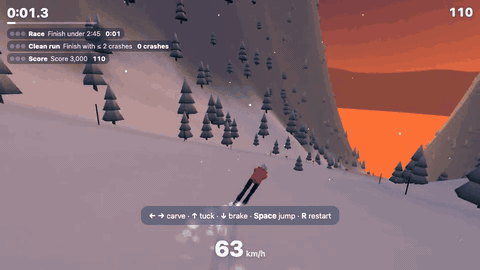
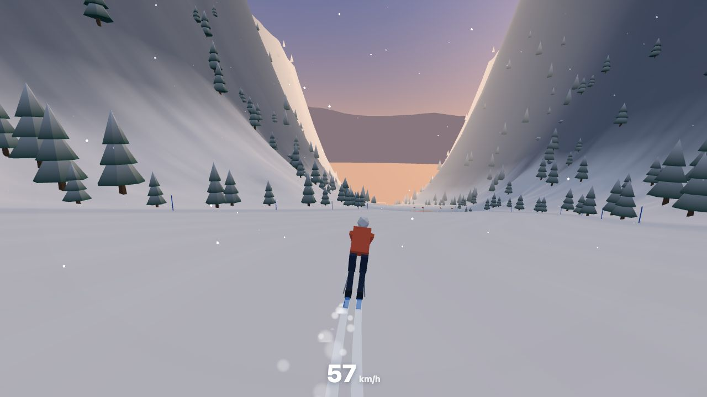
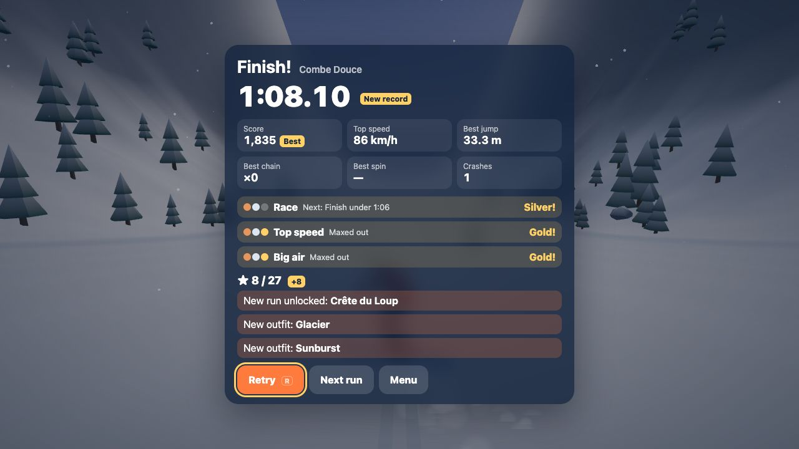
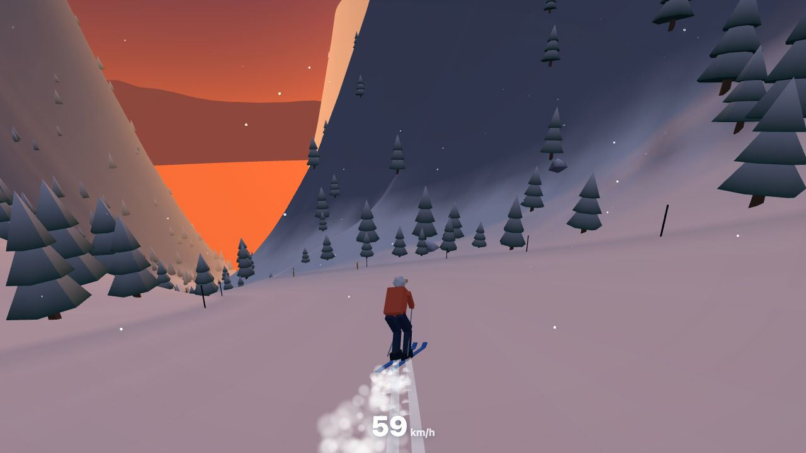
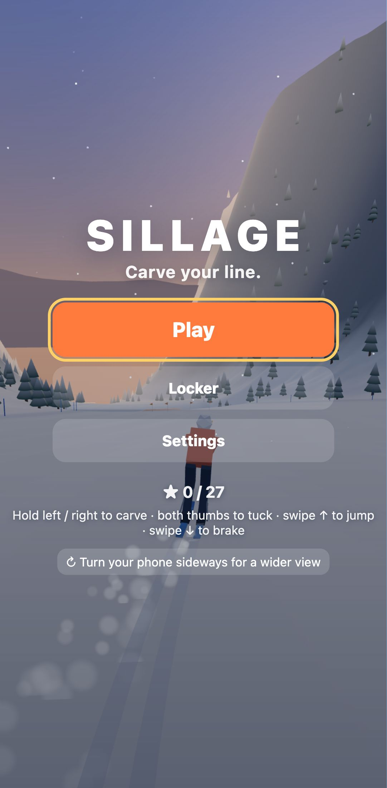

# Sillage

**Un jeu de ski en 3D low-poly, autour de la vitesse et du plaisir de la courbe. Il se joue dans le navigateur, sur téléphone comme sur ordinateur.**

> Le *sillage*, c'est la trace qu'on laisse derrière soi : ici, deux lignes nettes dans la neige fraîche.



▶ **Jouer :** [sillage-hazel-kappa.vercel.app](https://sillage-hazel-kappa.vercel.app)

Ce sont des descentes courtes, de 45 à 90 secondes, sur des montagnes générées par le code :
- **carve** pour garder ta vitesse, et **tuck** (position de recherche de vitesse) pour aller encore plus vite ;
- **frôle les sapins** pour enchaîner les « near-miss », et **saute** sur les tremplins ;
- puis appuie sur **Retry** et fais mieux.

**Free ride · Les Rousses** (bouton du menu) : le massif Dôle-Tuffes de la Station des Rousses (Jura), à l'échelle 1:1. Le relief est réel (tuiles de terrain AWS/Mapzen, 10 m), les pistes, remontées, forêts, routes et bâtiments viennent d'OpenStreetMap (`scripts/rousses.mjs` → `src/sim/rousses-data.ts`). On y trouve 36 km de pistes avec leurs vrais noms et couleurs, 4 télésièges (Dappes, Dappes - Tuffes, Jouvenceaux, Balancier) et 16 téléskis et tapis, plus le radar de La Dôle, les Jouvencelles, la vallée des Dappes et le Léman au loin. On embarque en arrivant à la gare du bas (assis sur un télésiège, tiré par la perche sur un téléski), n'importe quelle touche saute la montée, <kbd>↑</kbd> fait patiner sur les replats et <kbd>T</kbd> ramène au sommet de La Dôle. Données de carte © les contributeurs d'OpenStreetMap (ODbL).

Chaque défi a trois paliers (bronze, argent, or), et les étoiles débloquent de nouvelles pistes et de nouvelles tenues.

| | |
|---|---|
|  |  |
|  |  |

## Commandes

| Action | Clavier | Tactile | Manette |
|---|---|---|---|
| Carver à gauche / à droite | ← → ou A D | maintenir la moitié gauche / droite de l'écran | stick gauche ou croix |
| Tuck (vitesse) | ↑ ou W | maintenir les deux moitiés | RT |
| Freiner (dérapage) | ↓ ou S | glisser vers le bas et maintenir | LT ou B |
| Sauter | Espace | glisser vers le haut (ou le bouton ↑) | A |
| Vrille / salto en l'air | ← → / ↑ ↓ | maintenir un côté / glisser vers le haut ou le bas | stick |
| Grab en l'air (lâcher avant de toucher le sol) | maintenir Espace | maintenir les deux moitiés | maintenir A ou RT |
| Recommencer · Pause · Caméra | R · Échap · C | boutons à l'écran | Y · Start · Select |

**Options :**
- direction par inclinaison du téléphone, sensibilité de la direction, disposition pour gaucher ;
- caméra de poursuite ou vue casque ;
- un **mode confort** : champ de vision fixe, sans secousses ni roulis de caméra.

Un panneau de réglages en direct s'ouvre avec <kbd>~</kbd> ou <kbd>F2</kbd>.

## Ce qu'il y a dedans

- **Une physique du ski faite maison** (sans moteur physique), calculée 60 fois par seconde, avec un affichage interpolé :
  - gravité projetée sur la pente, frottement de la neige, résistance de l'air (debout, en tuck, en freinage) ;
  - carving limité par l'adhérence : si tu tournes trop fort, tu dérapes et tu perds de la vitesse ;
  - « pump » en rythme, envol sur les tremplins, vrilles et saltos, qualité de la réception, chutes et réapparition.
- **Un monde généré à partir de graines fixes** :
  - une ligne de piste qui serpente ;
  - un profil de pente lissé (interpolation d'Hermite cubique) ;
  - bosses, barres rocheuses, plaques de glace, forêts, portiques en rondins ;
  - sapins et rochers low-poly dessinés en instances ;
  - un terrain découpé en morceaux chargés au fil de la descente, avec 2 niveaux de détail ;
  - un ciel en dégradé, des sommets au loin et un lent cycle de la journée.
- **Un skieur réaliste** : un seul maillage articulé (20 os, 2 draw calls), technique de ski procédurale (angulation, jambe intérieure fléchie, contre-rotation, planté de bâton, tuck, poussée de bâtons, hockey stop, grabs, amorti des bosses, chute « yard sale »), ombre projetée.
- **Le « flow »** : enchaîner des virages propres en rythme fait jouer la musique note par note ; une jauge à 4 niveaux (jusqu'à « Sillage! ») fait monter musique, caméra et interface.
- **Des effets pour les sensations** :
  - champ de vision qui s'élargit avec la vitesse ;
  - secousses de caméra ;
  - vibration à grande vitesse ;
  - gerbes de neige, nuages de poudreuse, neige qui tombe ;
  - les traces des skis elles-mêmes ;
  - souffle sonore et ralenti quand tu frôles un obstacle.
- **Un son entièrement synthétisé** (WebAudio) :
  - vent qui monte et siffle avec la vitesse ;
  - crissement des carres et de la neige ;
  - bruit sourd des réceptions ;
  - musique d'ambiance générée.
- **La progression** :
  - 3 pistes × 3 défis × 3 paliers de médailles, calibrés grâce à des descentes simulées ;
  - records, déblocages et tenues sont sauvegardés dans le navigateur (`localStorage`).

## Lancer en local

Il faut Node.js 22.12 ou plus récent.

```bash
npm install
npm run dev          # http://localhost:5180
npm test             # 67 tests unitaires (physique, terrain, score, progression, équilibrage)
npm run test:e2e     # tests Playwright (ordinateur + mobile émulé) sur la version de production
npm run build        # vérification des types + version de production dans dist/
```

## Technique

Vite · TypeScript · Three.js · WebAudio · Vitest · Playwright. Aucun framework d'interface, aucun serveur.

```
src/
  sim/       logique pure et testable : physique du skieur, génération des pistes, score, défis, progression, bot
  render/    Three.js : terrain, décor, ciel, modèle du skieur, caméra, particules et traces
  audio/     synthèse sonore WebAudio
  input/     clavier, tactile, manette, inclinaison
  ui/        HUD, menus, résultats, panneau de réglages
docs/        documents de conception : GDD, FEEL, RESEARCH, ARCHITECTURE, RISKS, ROADMAP, DECISIONS, PERF
```

**Performances de la version de production :**

| Mesure | Résultat |
|---|---|
| Images par seconde, sur ordinateur | 60 |
| Images par seconde, sur mobile émulé (processeur ralenti 4 fois) | 60 |
| Appels de dessin par image | 52 à 58 |
| Triangles affichés | 62 000 à 76 000 |
| Poids total, compressé | 172 Ko |

Le détail est dans [docs/PERF.md](docs/PERF.md).

**Mise en ligne :** chaque push sur `main` lance les tests sur GitHub Actions et redéploie automatiquement le jeu sur Vercel.

## Crédits

C'est un jeu original. Ses mécaniques et ses sensations s'inspirent des jeux de ski en montagne et des jeux de course sans fin. Mais tout ce qu'on voit et entend (formes, couleurs, sons, musique) est généré par le code de ce dépôt.

## Licence

[MIT](LICENSE)
